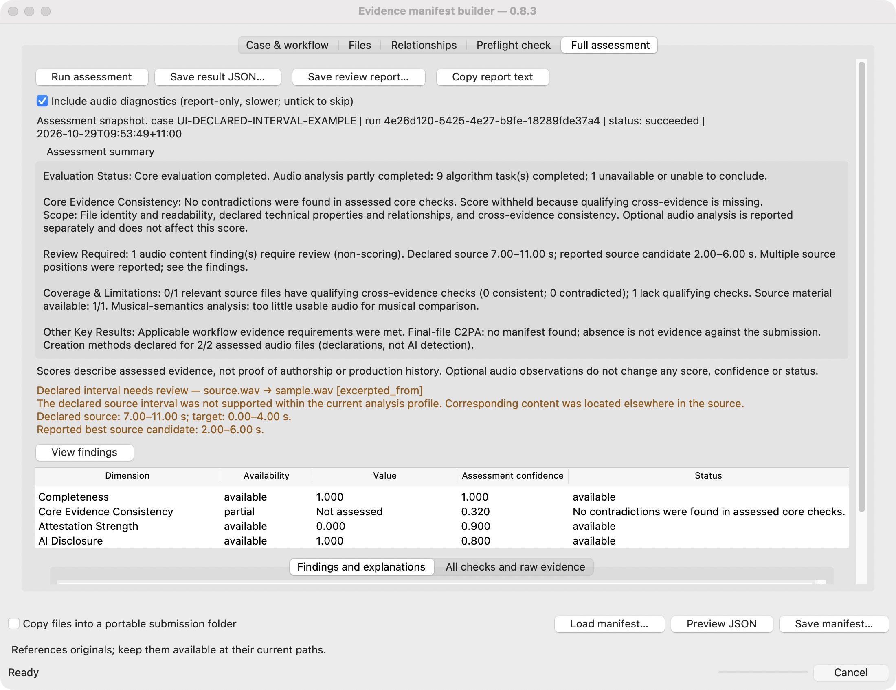

# Assessment result presentation in 0.8.3

Updated 29 October 2026. Summary wording refined without changing version 0.8.3. This release changes the GUI and human reports. The API
field remains `integrity`; its GUI label is **Core Evidence Consistency**.
The score, confidence, status, scoring policies and response schema are unchanged.

## Reading order

1. **Assessment summary:** five information blocks in one summary layer, in this order:
   Evaluation Status; Core Evidence Consistency; Review Required;
   Coverage & Limitations; Other Key Results. The core scope explicitly names
   file identity/readability, technical properties/relationships and cross-evidence
   consistency, and excludes optional audio analysis from that score.
2. **Important finding:** visible before the scores, with affected files and
   declared/candidate intervals. **View findings** focuses the full findings panel.
3. **Four dimensions:** original values and confidence; a high core value retains
   its contradiction count or incomplete state. `null` stays not assessed.
4. **Coverage and explanations:** material presence and qualified cross-checks
   are separate. Checked recordings include consistent and contradicted ones.
   Provider task counts are not counts of verified files or seconds.
5. **All checks and raw evidence:** supporting observations and the complete
   original response, including records not promoted to the attention list.

The summary uses complete sentences. Algorithm-task completion is reported
separately from interval-level review items; it does not display misleading zero
gap counters beside an unavailable provider. Missing evidence, failed execution,
withheld scores, absent C2PA and untrusted signers have distinct explanations.
Workflow and creation-method declaration coverage are included when structured
records are available; missing records remain unknown. No values are inferred
from a high completeness score or a zero attestation score.

In small windows, the Full assessment page scrolls so all five sections, findings
and scores remain reachable. Mouse-wheel and keyboard scrolling are supported,
and View findings moves to the detailed findings panel. The footer stays visible.
HTML and copied text use the same five sections. The version, scoring policy,
response schema and original response JSON are unchanged by this refinement.

The screenshot shows the controlled synthetic excerpt example, not customer
material: a declared 7–11 second source interval, corresponding content found
elsewhere, a withheld core score and 0/1 qualifying source cross-check coverage.

## Audio result mapping

| Structured outcome | Display treatment |
|---|---|
| `content_found_elsewhere` | Audio content finding requires review; declared and candidate intervals visible |
| `content_not_located` | Inconclusive comparison; no supported match located in analysed scope |
| `search_unavailable` | Local window observation plus wider-search gap |
| `insufficient_support`, `no_positive_control` | Unable to decide; no contradiction implied |
| `not_assessed`, `not_assessed_durations_differ`, `not_run`, `unavailable` | Analysis gap with original details |
| `declared_range_supported` | Supporting detail within the reported profile; no proof of provenance |
| Unknown outcome | Original state retained; no pass/failure interpretation |

The presentation reads structured outcomes, not English-message keywords. A
finding linked to its detailed range assessment counts once. Distinct selection
or window identities remain separate. Both audfprint and SpectroMap can contribute
observations to one review item; they are not two independent witnesses. All
reported supported offsets remain visible, including repeated-content ambiguity.

Bandwidth observations retain their heuristic wording in the detailed evidence.
Musical-semantics details retain the provider's internal correspondence scope,
even when its top-level status is inconclusive. Unknown or unpromoted records
remain in the complete raw response; successful checks are not deleted.

## Contract and scoring boundaries

- `build_review_presentation()` returns a detached model for human presentation.
  It does not mutate the response or add summary fields to response JSON.
- **Save result JSON…** retains the evaluator response. Existing private
  `_builder_notes` transport metadata is shown separately, as before.
- Optional audio findings retain `scoring_eligible: false` and
  `integrity_contribution: null`; no axis value, confidence or status is changed.
- Core checks such as `audio_samples_valid` remain core checks. The presence of
  the word audio is not used to classify a check as non-scoring.
- Presentation groups and colours do not create backend severity or axis states.
  Original severity and evidence references remain available in the report.
- This refinement retains version 0.8.3 and the existing backend source digest.
  The CSEC schema version stays `0.2-candidate`; policies, thresholds and
  evidence graphs are unchanged.

## Reports and snapshots

**Save review report…** writes offline HTML; **Copy report text** copies the
same display model. Names and messages are escaped in HTML, and the report loads
no external resources. Important findings are expanded for print. A report
records case/run IDs, capture time, original system metadata and display template
version. The GUI capture time is not a signed production timestamp.

File names and options are captured for the assessed submission. Editing a file,
relationship, workflow, declaration or analysis option marks the screen as a
previous assessment. Export still describes that original snapshot; rerun to
assess the changed submission.

Implementation: `builder_results.py` (existing check adapters), `builder_review.py`
(pure presentation), `builder_report.py` (HTML), `builder_gui.py` (Tk widgets).
Tests: `tests/test_builder_review.py`, three added `test_builder.GuiTests` cases,
and the real declared-range integration case in `test_audio_diagnostics.py`.
